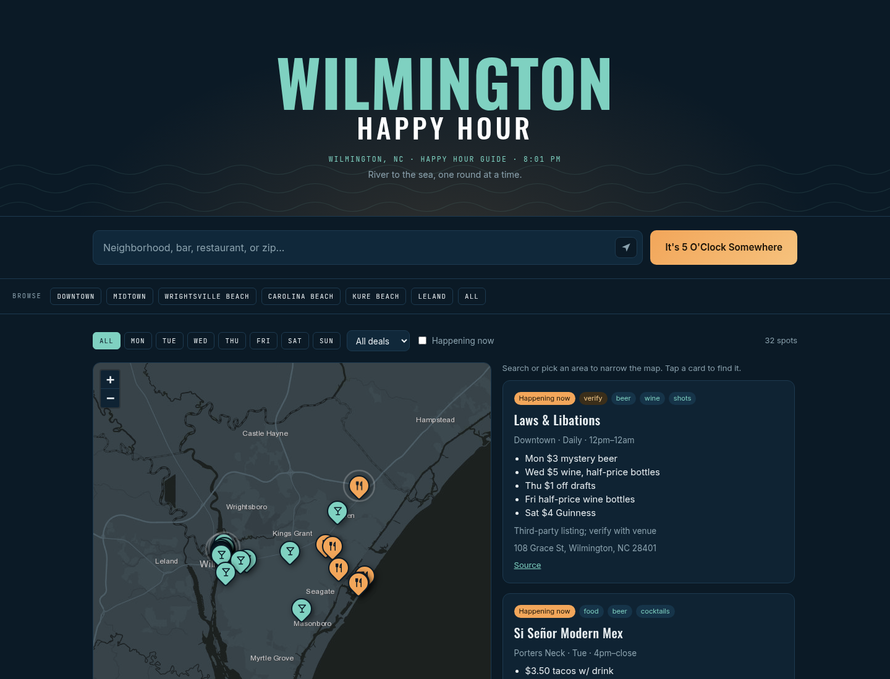

# Wilmington Happy Hour

A happy hour finder for **Wilmington, NC** and nearby beaches. Search by neighborhood, bar, restaurant, or zip, browse the spots on an interactive map, and filter by day, deal type, or what's happening right now.

**Repo:** [5pm-ILM](https://github.com/johnnycchapman/5pm-ILM)  
**Live:** https://5pmilm.com (also https://johnnycchapman.github.io/5pm-ILM/)



## Who it's for
Locals and visitors looking for their next happy hour spot, from Downtown and the Riverfront to Wrightsville, Carolina, and Kure Beach.

## Features
- **Search:** matches spot names, neighborhoods, street addresses, and zip codes.
- **Browse chips:** Downtown, Midtown, Wrightsville Beach, Carolina Beach, Kure Beach, Leland, or All.
- **Interactive map:** built with Leaflet on a dark basemap. Bars get a cocktail-glass pin and restaurants a fork-and-knife pin, and spots happening now pulse. Clicking a pin opens a popup with today's times, the deals, and links. The map follows every filter and zooms to fit the results.
- **Filters:** day of week, deal type (beer, wine, cocktails, shots, food, other), and *Happening now* (based on the current local time).
- **Cards:** a list beside the map on desktop and below it on mobile. Click a card to fly to its pin.
- **Use my location:** sorts spots by distance, for spots that have coordinates.
- **Live clock:** shows Wilmington's local time in the header.

## How the data works
All spots live in [`data/spots.json`](data/spots.json). Each entry has:

| Field | Meaning |
| --- | --- |
| `name`, `neighborhood`, `address`, `zip` | Where it is |
| `lat`, `lng` | Map coordinates, geocoded with OpenStreetMap Nominatim (`null` = not mapped) |
| `venueType` | `bar` or `restaurant` (sets the map icon) |
| `days` | e.g. `["Mon","Tue"]` |
| `start`, `end` | 24h `"HH:MM"` (or `"close"`). Blank if times weren't published |
| `deals`, `dealTypes` | Deal text, plus tags used by the filters |
| `website`, `source` | Venue site, plus the page the deal info came from |
| `verified`, `notes` | `false` / "verify with venue" means it couldn't be fully confirmed |

Deals were researched from public sources like ILMWeekly's daily deal pages and venue websites, as of October 2026. **Happy hour deals change often. Always confirm with the venue.** Nothing is invented. Anything unconfirmed is flagged.

## Run it locally
It's plain HTML/CSS/JS with no build step:
```bash
python3 -m http.server 8000
# open http://localhost:8000
```
(Opening `index.html` directly from disk won't load the data because of browser file:// rules. Use a local server.)

## Update or add spots
1. Edit `data/spots.json`: add or change an entry using the fields above, and include a `source` URL.
2. Look up coordinates for new addresses (for example on nominatim.openstreetmap.org) and fill in `lat`/`lng`.
3. Bump the cache-bust version (`?v=3` → `?v=4`) in `index.html` and in the `fetch` call in `js/app.js`, so visitors get the new data.
4. Commit and push. GitHub Pages redeploys automatically.

To rename the site, change the text marked `data-site-name` in `index.html`.

## Deploy
Hosted on GitHub Pages from the `main` branch root of **5pm-ILM** (`.nojekyll` included). Custom domain: https://5pmilm.com. The github.io URL remains https://johnnycchapman.github.io/5pm-ILM/. All asset paths are relative, so it works under `/5pm-ILM/`.

Map tiles © Esri, HERE, Garmin, © OpenStreetMap contributors.
